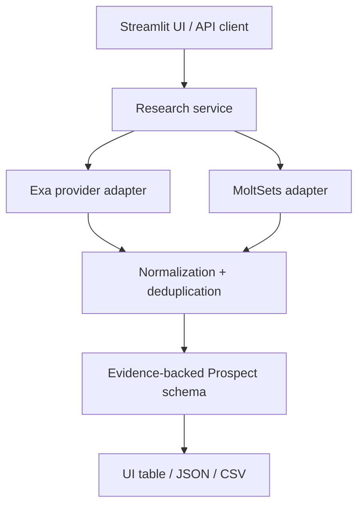

# GTM Intelligence Explorer

An evidence-first proof of concept for B2B prospect research and enrichment. It accepts a company or ideal-customer description, searches public web sources with Exa, normalizes returned results, preserves source URLs, and exposes a provider adapter boundary for MoltSets.

> **Status:** Starter prototype; live Exa research requires an API key. MoltSets is deliberately disabled until the exact endpoint, authentication and payload are confirmed. No fake company/contact enrichment is inserted.

## Features

- Natural-language ICP/company query with employee range, technology and growth-signal criteria.
- Server-side Exa API integration through the official Python SDK.
- Source URL, publication date and highlights preservation where returned.
- Normalized JSON schema and deduplication.
- Streamlit dashboard with JSON and CSV exports.
- FastAPI endpoint (`POST /research`) and health endpoint (`GET /health`).
- Clear missing-data states and provider error handling.
- Unit tests for normalization, deduplication and query construction.
- `.env`-based configuration; keys are not exposed in the frontend.

## Architecture



The current flow treats Exa results as candidate evidence. It does **not** claim that every search result is a distinct company or that every requested filter has been verified. Technology usage, employee count, decision-maker and contact fields remain unavailable until a source or provider supports them.

## Setup

Python 3.10+ recommended.

```bash
python -m venv .venv
# Linux/macOS
source .venv/bin/activate
# Windows PowerShell: .venv\Scripts\Activate.ps1

pip install -r requirements.txt
cp .env.example .env
```

Add the Exa API key to `.env`:

```env
EXA_API_KEY=your_exa_key
```

Do not commit `.env`. Keep keys on the server side only.

## Run the dashboard

```bash
streamlit run app/main.py
```

## Run the API

```bash
uvicorn app.api:app --reload
```

Health check: `GET http://127.0.0.1:8000/health`

Example request:

```bash
curl -X POST http://127.0.0.1:8000/research \
  -H "Content-Type: application/json" \
  -d '{
    "company_or_ideal_customer": "B2B SaaS companies using HubSpot or Salesforce",
    "research_objective": "Find evidence of sales-team expansion",
    "employee_min": 50,
    "employee_max": 500,
    "technologies": ["HubSpot", "Salesforce"],
    "growth_signals": ["Sales hiring"],
    "max_results": 8
  }'
```

## Exa integration

Uses the official `exa-py` SDK, calls search server-side, requests highlights and preserves URLs and publication dates when provided. API errors are converted into actionable user-facing messages; empty results return an empty list. Refer to [Exa documentation](https://exa.ai/docs) and [official Python SDK](https://github.com/exa-labs/exa-py).

## MoltSets integration status

The assignment and founder transcript refer to "Mole Set". Public research suggests the provider may be **MoltSets**, whose official website advertises company/people search and enrichment APIs. Confirm the provider name and access with Outmate before enabling integration.

Official resources:
- [MoltSets website](https://moltsets.com/)
- [MoltSets developer docs](https://developer.moltsets.com/)
- [MoltSets API quick start](https://support.moltsets.com/en/articles/14743482-moltsets-quick-start-guide)

The adapter is intentionally a provider boundary and refuses to run until `MOLTSETS_API_KEY`, `MOLTSETS_BASE_URL`, and `MOLTSETS_SEARCH_COMPANIES_PATH` are configured. The exact endpoint and payload are not assumed because the assignment says to verify capabilities first. After Outmate confirms the endpoint, update `app/providers/moltsets_adapter.py` to match the official schema, auth and response fields, then add mocked tests. Do not set a guessed endpoint and treat its response as verified.

## Product exploration summary

| Product | Main problem/workflow | Useful pattern for this prototype |
|---|---|---|
| Orange Slice | Natural-language prospecting; enriched lead lists; research and workflow execution | ICP prompt, spreadsheet-like results, evidence-backed fields, export |
| Outmate (from assignment/transcript) | GTM research, account discovery, enrichment and outbound automation | One wrapper over data providers; source authenticity; usage/cost awareness |
| Clay (founder-described competitor) | GTM data orchestration and enrichment workflows | Modular enrichment steps; not in scope to reproduce full platform |

Observed reference workflows:
1. User describes target accounts in natural language.
2. Product discovers candidates across data sources.
3. Results are enriched with company/contact fields and signals.
4. User inspects a table and exports/uses results.
5. Data quality and source reliability are essential to trust.

Recommendation: first ship one reliable account-research workflow, then add provider-backed filters, verified decision-maker lookup, saved runs and credit accounting only when the relevant APIs expose reliable usage data.

## Data quality and limitations

- Search results are evidence candidates, not a guaranteed canonical company database.
- Employee count, industry, technology stack and growth signals are not filled unless a supported source/provider returns them.
- Current normalization uses result title/highlights as a preliminary company label and description; a production version should use page content and entity resolution to separate company names from article titles.
- Fit scoring is not currently calculated because no calibrated evidence rubric was supplied. The UI labels prospects "Needs review" instead of inventing a score.
- Decision-makers and contact information remain empty unless a provider returns them through an authorized endpoint.
- No automated outreach, LinkedIn scraping, CRM writes or paid API plans are included.
- Usage/cost display is not implemented because API usage metadata and billing rates have not been confirmed.
- MoldSets endpoint/auth schema must be confirmed with Outmate before live integration.
- The app needs integration tests against real credentials before claiming end-to-end validation.

## Tests

```bash
pytest -q
```

## Demo script (2–3 minutes)

1. Explain the goal: turn an ICP prompt into sourced prospect research.
2. Enter: "B2B SaaS companies using HubSpot or Salesforce, 50–500 employees, expanding sales teams."
3. Run research with an authorized Exa key.
4. Open a result and show source URLs/highlights.
5. Show missing fields labelled unavailable rather than guessed.
6. Download JSON and CSV.
7. Explain the MoldSets adapter is awaiting confirmed endpoint/account access, and show the modular integration boundary.
8. Briefly show tests and README setup.

## Suggested next steps

1. Get Exa and MoltSets access from Outmate.
2. Confirm whether "Mole Set" means MoltSets and verify endpoint access/schema.
3. Add integration tests using mocked HTTP responses.
4. Improve company entity resolution and extract field-specific evidence.
5. Add explicit match reasons per ICP filter and only mark criteria matched when supported.
6. Add usage and cost tracking after provider metadata/pricing are confirmed.
